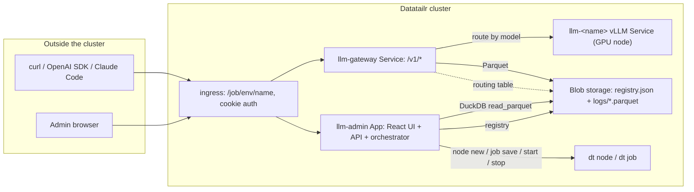
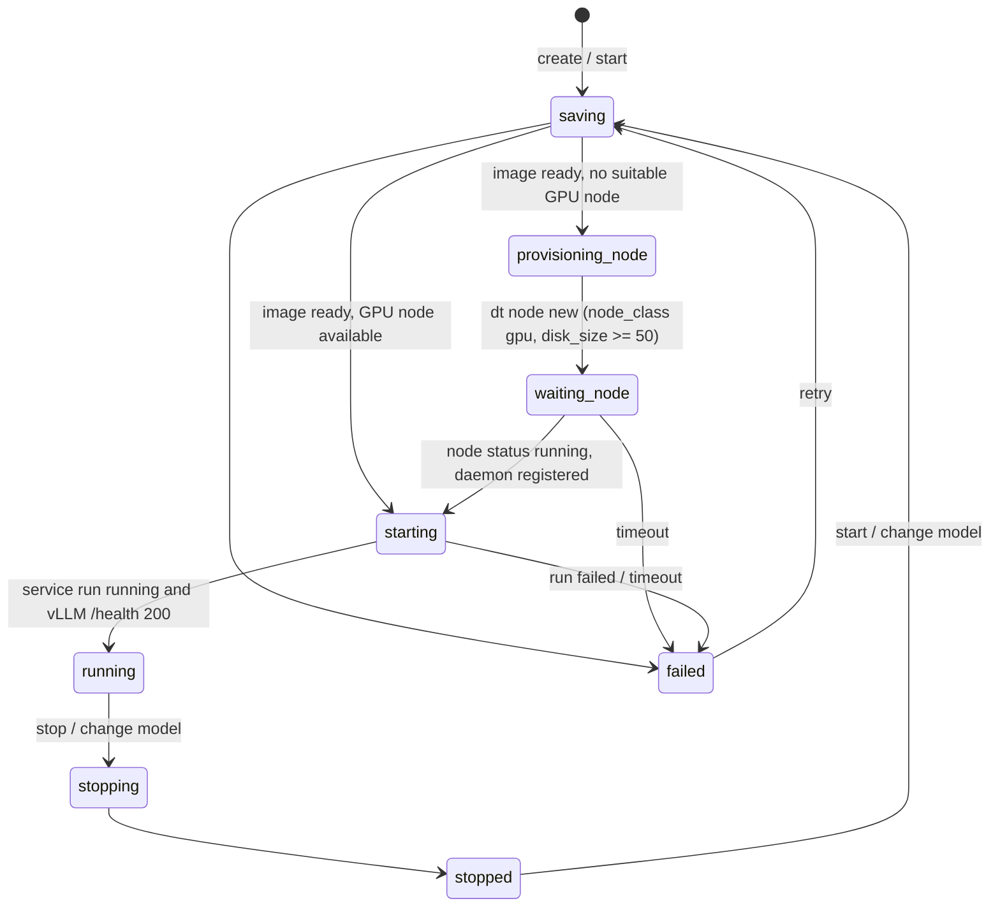

# LLM Deployment Platform on Datatailr

Deploy, manage and observe self-hosted LLMs on a Datatailr cluster. The platform takes care of the parts that are tedious by hand: building the vLLM image, making sure a GPU node with enough disk is running before the service starts, exposing every model through one OpenAI-compatible URL, and logging every request and reply so an administrator can see who used what.

## Components

| Component | Datatailr job | What it does |
|---|---|---|
| **LLM Admin** (`llm_platform/admin_app` + `frontend/`) | App (`framework="fastapi"`) | React UI and API for administrators. Runs the orchestrator that creates GPU nodes and per-LLM services. Queries request logs with DuckDB. |
| **LLM Gateway** (`llm_platform/gateway`) | Service | One OpenAI-compatible endpoint (`/v1/chat/completions`, `/v1/completions`, `/v1/embeddings`, `/v1/models`, `/v1/messages`). Routes by `model` to the right vLLM service, preserves streaming, logs request/reply as Parquet to blob storage. |
| **vLLM service** (`llm_platform/vllm_service`) | Service (one per LLM, created at runtime) | Installs vLLM into a venv on first start (see [Why vLLM is installed at runtime](#why-vllm-is-installed-at-runtime)) and runs the OpenAI API server for a Hugging Face model on a GPU node. |
| **`datatailr-llm` skill** (`skills/datatailr-llm`) | – | Portable agent skill telling a coding agent how to call the gateway. |



## Deploy

```bash
# 1. Build the UI (ships inside the Python package)
cd llm-deployment/frontend && npm install && npm run build && cd ..

# 2. Deploy the gateway and the admin app (run as the administrator who owns the installation)
python deploy.py            # or: python deploy.py gateway | python deploy.py admin
```

Open **LLM Admin** from *AI & Integrations*. Members of the `admin` group see every page; other users only see **Connect**.

## Deploying an LLM

**LLMs → New LLM**: name, Hugging Face model id, GPU instance type, node disk size (minimum 50 GB), `vram`/CPU/memory for the container, optional extra `vllm serve` arguments and the name of a Datatailr secret holding a Hugging Face token for gated models.

The orchestrator then walks each LLM through this state machine:



1. **saving** – the vLLM `Service` is saved (`dt job save`); the platform builds a small image (Python, `uv`, `gcc`, ~1.5 min). The scheduler skips the build when the image definition is unchanged. If a build fails the job goes back to `created` with `last_build_succeeded=false`; the orchestrator reports the last `ERROR` line from the build log in the LLM's events and **Retry** forces a fresh build (it appends a rebuild token to the build script, because the scheduler never rebuilds an identical definition). The *build* tab on the LLM page shows the full build log.
2. **provisioning_node / waiting_node** – if no running GPU node in the environment can fit the request (free CPU/RAM and known GPU memory), a node is created from `llm_platform/common/gpu_node_template.json` with the chosen instance type and `disk_size`. The orchestrator waits until `dt node ls` reports it `running` with CPUs registered (about 7 min on Azure). If the platform reclaims the node before the service lands on it, the orchestrator provisions another one.
3. **starting** – `dt job start`; the orchestrator polls the run and vLLM's `/health` until the model is loaded. On first start the service installs vLLM (~2.5 min on a T4 node), then downloads the weights.
4. **running** – the gateway picks the LLM up from the registry within ~15 s and starts routing requests whose `model` is the LLM name or the HF id.

**Change model** stops the service, re-saves it with the new `LLM_MODEL` (no rebuild, the image is unchanged) and starts it again. Measured end to end with a 1.5B model on an existing node: under 6 minutes.

### Why vLLM is installed at runtime

Baking vLLM + CUDA into the job image produces a ~10 GB layer, and the cluster's internal registry drops the connection while that layer is pushed (`connection refused` after ~70 s, reproducible). The image therefore only contains `uv`, and `vllm_service/main.py` creates a venv (`uv venv` + `uv pip install vllm`) on the node before exec'ing the API server. Set `LLM_VLLM_SPEC` on the admin app (for example `vllm==0.31.0`) to pin the version; the venv name includes a hash of the spec and the Python version, so several specs can coexist.

Where the venv, the `uv` cache and the Hugging Face cache live depends on who the service runs as:

- Default: the service runs as the deploying user, which cannot write to `/mnt` on the node, so everything goes to `/tmp/llm_platform` inside the container and is **lost on every restart** (vLLM is re-installed, weights re-downloaded).
- Persistent: set `LLM_SERVICE_RUN_AS=root` on the admin app and allow the deploying user to run jobs as root (`dt user modify root --users <admin-user>`). The caches then live in `/mnt/llm_platform` on the node and are shared by every LLM on it. This is a security decision for the cluster administrator; the platform works without it.

### GPU nodes

The autoscaler does not start GPU nodes; this platform creates them. Idle nodes without jobs are reclaimed by the platform. The **GPU nodes** page shows every GPU node, its utilisation, the LLM services on it and the price, and lets an administrator create, start, stop or terminate nodes (termination asks you to type the node name). Stopping an LLM does not stop its node: the node keeps costing money until the platform reclaims it or an administrator stops it from the GPU nodes page.

On T4 nodes (`Standard_NC4as_T4_v3`, compute capability 7.5) vLLM falls back from bf16 to fp16 and uses the Triton attention backend; the Triton JIT needs a C compiler, which is why `build_script_pre.sh` installs `gcc` and `libc6-dev`.

## Using the LLMs

Everything goes through the gateway:

- Outside the cluster: `https://<domain>/job/<env>/llm-gateway/v1`, authenticated with the cookie `DatatailrUser=<token>` (or the query parameter `?__datatailr_user_cookie__=<token>`). Users generate a personal token on the **Connect** page (same mechanism as the Excel add-in; regenerating invalidates the previous token). `Authorization: Bearer` is not accepted by the Datatailr ingress, which is why Cursor's custom base URL does not work.
- Inside the cluster: `http://llm-gateway/job/<env>/llm-gateway/v1`; the platform injects the job's identity.
- A request for a model that is not running gets `404 {"error": {"message": "Model 'x' is not running. Available models: ..."}}` from the gateway; a wrong or missing token gets a `302` to the login page from the ingress.
- Long non-streaming generations: the in-cluster auth proxy between the gateway and vLLM closes a connection that is silent for 60 s. Use `"stream": true` for answers that may take longer than that to generate; streaming keeps data flowing and is unaffected.
- Claude Code: vLLM serves the Anthropic Messages API at `/v1/messages`; the Connect page prints the `ANTHROPIC_*` environment variables.

The **Connect** page has copy-paste snippets for curl, the OpenAI Python and Node SDKs, `requests`, Claude Code and internal jobs.

## Observability

The gateway logs one record per request (`user`, `model`, `deployment`, `endpoint`, `status`, `latency_ms`, token counts, request JSON, reply text, error) and flushes Parquet files to `llm_platform/logs/date=YYYY-MM-DD/` in blob storage every 10 s. Set `LOG_BODIES=false` on the gateway to drop prompts and replies.

The admin app mirrors new files to a local cache and queries them with DuckDB: **Requests** (filter by user, model, status, time, full-text search, full prompt/reply drawer), **Users** (usage per user) and the **Overview** charts.

## Layout

```
llm-deployment/
├── llm_platform/                 # the deployable package (everything the jobs need)
│   ├── common/                   # schemas, naming, registry store, log store (DuckDB), dt node helpers, node template
│   ├── vllm_service/             # main(port) -> vllm serve; requirements.txt; build_script_pre.sh
│   ├── gateway/                  # FastAPI gateway service
│   └── admin_app/                # FastAPI admin API, orchestrator, built UI in static/
├── frontend/                     # React + Vite + Tailwind source for the admin UI
├── skills/datatailr-llm/         # agent skill for consumers of the gateway
└── deploy.py                     # deploys gateway + admin
```

## Local development

```bash
# backend against the real cluster, with a dev identity (never set LLM_PLATFORM_DEV_USER on a deployed job)
LLM_PLATFORM_DEV_USER=<your-username> DATATAILR_DOMAIN=<domain> \
  python -m uvicorn llm_platform.admin_app.app:app --port 8008 --reload

# UI with hot reload, proxying /api to the backend
cd frontend && npm run dev
```

## Notes and limits

- Only `admin` group members (plus the deploying user) can manage LLMs and nodes. Any signed-in user can use **Connect** and call the gateway (the gateway and vLLM services are deployed with `ACCESS` for `dtusers`).
- The gateway and the admin app must run as the same user: both read and write the registry and logs in that user's blob bucket. `deploy.py` uses the signed-in user for both.
- GPU memory per instance type comes from a table in `llm_platform/common/dt_nodes.py`; unknown types are treated as "one LLM per node".
- `dt node new` returns before the VM is reachable; node readiness is detected from `dt node ls`. Timeouts are configurable with `LLM_NODE_READY_TIMEOUT`, `LLM_SERVICE_READY_TIMEOUT` and `LLM_BUILD_TIMEOUT` (seconds) on the admin app.
- The container `vram` request is written into the job definition directly (`vram` field, bytes) because the installed SDK's `Resources` class does not expose it yet; newer SDKs accept `Resources(vram=...)` and the code switches to it automatically. The orchestrator also derives vLLM's `--gpu-memory-utilization` from `vram` and the instance type's GPU memory so several LLMs can share one GPU.
- The gateway opens a new connection to vLLM for every request and strips the ingress's identity headers before forwarding: the in-cluster auth proxy only injects the caller's identity into the first request of a TCP connection, and a duplicated `X-Datatailr-User` header makes vLLM's auth guard answer `404 {"error":"Not found"}`.
- Admin-app environment variables: `LLM_VLLM_SPEC`, `LLM_SERVICE_RUN_AS`, `DATATAILR_DOMAIN` (public host for the Connect snippets; derived from the request `Host` when unset), `LOG_BODIES` (gateway).
